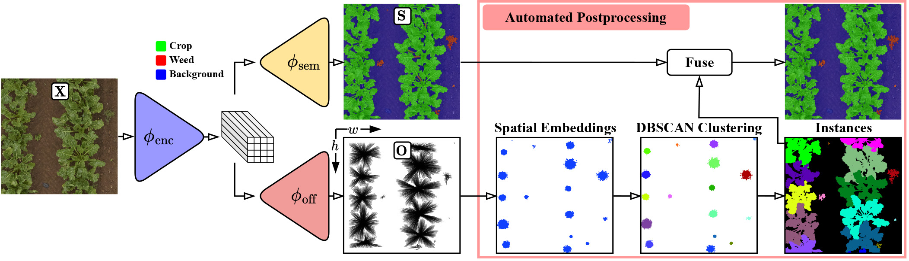
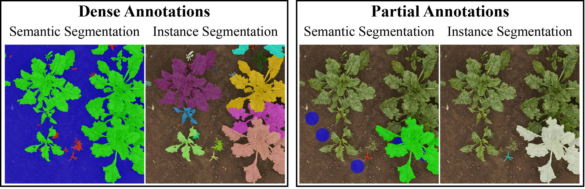

# PSPA

*[Panoptic Segmentation with Partial Annotations for Agricultural Robots](https://www.ipb.uni-bonn.de/wp-content/papercite-data/pdf/weyler2024ral.pdf)*

We present a novel approach to leverage partial annotations for panoptic segmentation.
These partial annotations contain
ground truth information only for a subset of pixels per image and are thus
much faster to obtain than dense annotations. We propose a novel set of losses
that exploit measures from vector fields used in physics, i.e., divergence and
curl, to effectively supervise predictions without ground truth annotations.



Exemplary, we show in the following figure a comparision between dense annotations (left)
and partial annotations (right). The former contains ground truth annotations 
for all instances, i.e., *things*, and each pixel in the background, i.e., *stuff*.
In contrast, the latter annotations contain annotations for a few instances and 
some blob-like labels for the background.



# Setup
We use miniconda to setup a virtual environment.
The following script will install miniconda in case it is not already installed and setup a virutal environment denoted as *pspa*
```bash
chmod +x ./setup.sh
./setup.sh
```

# Pretrained Models
- We provide the [pretrained model](https://uni-bonn.sciebo.de/s/7gDikkAynXM3avv) using ERFNet as network architecture

# Datasets
- We use the [PhenoBench](https://www.phenobench.org/) dataset

# Inference

Before you start the inference you need to specify the path to the dataset in the corresponding configuration file, e.g.:
```yaml
data:
  path: data/PhenoBench/test
```

Next, you can run the model in inference mode
```python
conda activate pspa
python predict.py --config ./config/config-phenobench.yaml  --export <path/to/export_dir> --ckpt <path/to/checkpoint/model.ckpt>
```
In the specified ```<path/to/export_dir>``` you will find the predicted semantics and plant instances.

In case you want to apply our proposed *merging procedure* you need run the following subsequently
```python
conda activate pspa
python auxiliary/merge_plants_sem.py --semantics <path/to/previously/predicted/semantics> --plants <path/to/previously/predicted/plant/instances> --export <path/to/merged_export_dir>
```

# Training
Similiarly you can train a new model
```python
conda activate pspa
python train.py --config ./config/config-phenobench.yaml --export <path/to/export_dir>
```

# License
This software is released under a creative commons license which allows for personal and research use only. For a commercial license please contact the authors. You can view a license summary [here](https://creativecommons.org/licenses/by-nc/4.0/).
